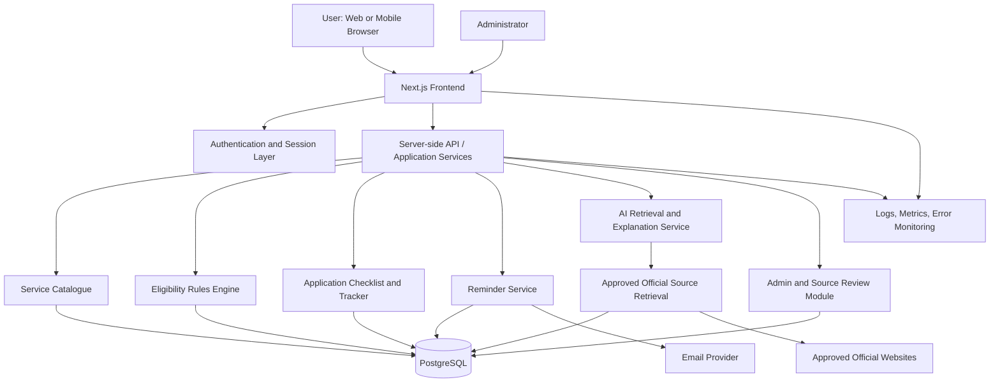
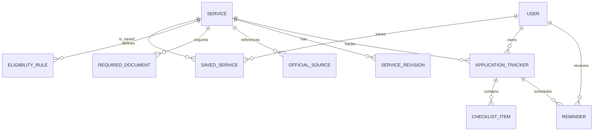
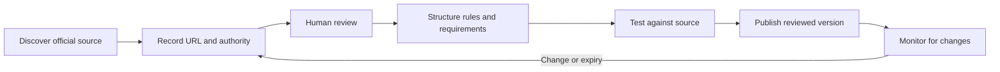
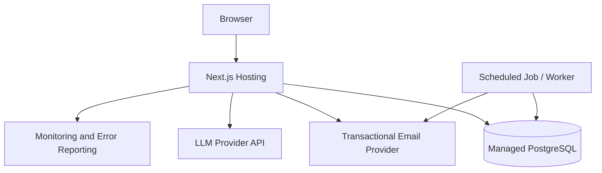

# SETUVA — System Architecture

> **Document type:** Technical architecture  
> **Project:** SETUVA (formerly ApplyRight) — AI-Powered Government Application Companion  
> **Status:** Proposed architecture for the MVP  
> **Primary MVP audience:** Students and residents in Karnataka, India  
> **Primary MVP use case:** Discover relevant government schemes/services, understand published eligibility criteria, prepare document checklists, and track application-preparation progress.

---

## 1. Purpose and Scope

ApplyRight helps users navigate government service information by turning published requirements into a clear, source-backed workflow.

The MVP will:

1. Let users search and browse a curated catalogue of government services and schemes.
2. Ask structured questions relevant to a service's published eligibility rules.
3. Show a transparent eligibility assessment, including uncertainty and missing information.
4. Generate a document and task checklist based on verified service information.
5. Let authenticated users save services and track their own preparation progress.
6. Provide AI-assisted explanations grounded in approved official sources.
7. Give authorized administrators tools to review, update, and audit service information.

### Explicit MVP boundaries

- ApplyRight is an informational companion; it is not a government authority.
- It does not guarantee eligibility, approval, or benefit disbursement.
- It does not submit applications to government portals unless an authorized integration is implemented and separately verified.
- It does not claim to know a submitted application's official status unless a verified, authorized integration provides that status.
- It will not require Aadhaar numbers, bank details, or copies of sensitive identity documents for the core MVP.
- The AI assistant must not invent eligibility rules, documents, deadlines, fees, or official links.

## 2. Architecture Principles

- **Official sources first:** Important claims must be linked to an approved official source.
- **Rules before generative AI:** Eligibility is evaluated using structured rules wherever possible. AI explains results; it does not independently decide eligibility.
- **Transparent uncertainty:** Use `eligible`, `potentially_eligible`, `not_eligible`, or `insufficient_information` outcomes as appropriate.
- **Secure by default:** Enforce authorization on the server, minimize personal data, and protect administrative functions.
- **Versioned information:** Keep source URLs, verification dates, and change history for published requirements.
- **Modular monolith for MVP:** Start with one deployable application and a separate database. Avoid microservices until scale or team boundaries justify them.
- **Accessible and mobile-first:** Design for low-bandwidth use, keyboard navigation, and small screens.
- **Observable and testable:** Log important operational events without recording secrets or unnecessary sensitive user content.

## 3. High-Level System Architecture



### Main components

| Component | Responsibility |
|---|---|
| Next.js frontend | Search, service details, eligibility wizard, checklist, dashboard, admin UI |
| Authentication layer | Sign-in, sessions, account lifecycle, role checks |
| Application services | Validate requests and orchestrate domain workflows |
| Service catalogue | Store and search schemes/services and their current published details |
| Eligibility engine | Evaluate structured rules and return explainable outcomes |
| Checklist tracker | Create and persist user-specific preparation tasks |
| AI retrieval service | Retrieve approved source material and generate cited explanations |
| Source review module | Manage verification, revisions, and publication status |
| PostgreSQL | Persistent application and catalogue data |
| Reminder service | Schedule user-requested reminders and send notifications |
| Observability | Operational logs, errors, latency, and security-relevant events |

## 4. Recommended Technology Stack

| Layer | MVP choice | Notes |
|---|---|---|
| Language | TypeScript | Shared types across UI and server |
| Web application | Next.js App Router | Server-rendered pages and server-side handlers |
| UI | React + Tailwind CSS | Responsive, accessible components |
| API | Next.js Route Handlers | Keep the MVP as a modular monolith |
| Validation | Zod | Validate requests and environment configuration |
| Database | PostgreSQL | Relational data, constraints, and full-text search |
| ORM | Prisma | Schema migrations and typed queries |
| Authentication | Auth.js or a maintained identity provider | Configure secure cookies and session handling |
| AI integration | Server-side LLM provider adapter | Provider can be changed without changing domain logic |
| Retrieval | PostgreSQL full-text search initially | Add vector retrieval only if evaluation proves it useful |
| Testing | Vitest + Playwright | Unit, integration, and end-to-end tests |
| Deployment | Vercel or equivalent Node-compatible host | Use managed PostgreSQL with backups |
| Email | Transactional email provider | For opt-in reminders only |
| Error monitoring | A reputable monitoring provider | Redact personal data and secrets |

Do not add a separate Python service unless there is a demonstrated need for specialized processing. The initial product can be built with Next.js, TypeScript, PostgreSQL, and Prisma.

## 5. Application Structure

A suggested repository layout:

```text
applyright/
├── app/
│   ├── (public)/
│   │   ├── page.tsx
│   │   ├── services/
│   │   │   ├── page.tsx
│   │   │   └── [slug]/page.tsx
│   │   └── about/page.tsx
│   ├── (auth)/
│   │   ├── sign-in/page.tsx
│   │   └── register/page.tsx
│   ├── dashboard/
│   │   ├── page.tsx
│   │   ├── saved-services/page.tsx
│   │   └── applications/
│   │       └── [id]/page.tsx
│   ├── admin/
│   │   ├── page.tsx
│   │   ├── services/page.tsx
│   │   └── sources/page.tsx
│   └── api/
│       ├── services/route.ts
│       ├── services/[id]/route.ts
│       ├── eligibility/check/route.ts
│       ├── saved-services/route.ts
│       ├── applications/route.ts
│       ├── applications/[id]/route.ts
│       ├── applications/[id]/checklist/route.ts
│       ├── assistant/ask/route.ts
│       └── reminders/route.ts
├── components/
│   ├── ui/
│   ├── service-card.tsx
│   ├── eligibility-wizard.tsx
│   ├── checklist.tsx
│   └── source-citation.tsx
├── lib/
│   ├── auth/
│   ├── db/
│   ├── validation/
│   ├── security/
│   ├── logging/
│   └── env.ts
├── modules/
│   ├── services/
│   ├── eligibility/
│   ├── applications/
│   ├── sources/
│   ├── assistant/
│   ├── reminders/
│   └── admin/
├── prisma/
│   ├── schema.prisma
│   └── migrations/
├── tests/
│   ├── unit/
│   ├── integration/
│   └── e2e/
├── public/
├── .env.example
├── ARCHITECTURE.md
├── README.md
└── package.json
```

Keep business rules in `modules/` rather than embedding them in React components or route handlers. Route handlers should validate input, authorize the caller, invoke a service, and return a consistent response.

## 6. Core Data Model

The following is the proposed logical data model. Exact fields should be refined during implementation.

### Main entities

- **User:** Account identity, locale, timestamps, and minimal preferences.
- **Service:** Government service or scheme, slug, category, jurisdiction, description, official application URL, status, and current version.
- **EligibilityRule:** A structured rule linked to a service, with operator, field, expected value, and explanation.
- **RequiredDocument:** Document name, whether mandatory or conditional, guidance, and linked source.
- **OfficialSource:** Source URL, issuing authority, source type, last checked date, verification status, and source metadata.
- **ServiceRevision:** Immutable or append-only record of material changes to service information.
- **SavedService:** Association between a user and a service.
- **ApplicationTracker:** A user's preparation tracker for a service, with a local progress status.
- **ChecklistItem:** A preparation task, source reference, completion state, and optional note.
- **Reminder:** User-selected reminder time, timezone, delivery status, and related tracker.
- **AuditLog:** Administrative changes and security-relevant actions, with limited metadata.

### Relationship overview



### Data design requirements

- Use UUIDs or equivalent non-guessable identifiers for user-owned records.
- Add foreign keys, unique constraints, indexes, and timestamps.
- Store dates as timezone-aware timestamps where appropriate; store the relevant service jurisdiction and user timezone explicitly.
- Store official URLs as data, validate them, and only publish links after review.
- Track service and rule revisions so previous eligibility results can be understood in context.
- Do not store uploaded document contents in the MVP. If uploads are added later, use private storage, access checks, retention limits, malware scanning, and explicit consent.
- Do not store full eligibility questionnaire answers longer than needed. Keep only the minimum data needed for the user's requested feature.

## 7. Eligibility Engine

Eligibility decisions should be reproducible and explainable.

### Input

- Service ID and version
- User answers relevant to the service
- Rule version and effective date

### Processing

1. Load the published service version and its active eligibility rules.
2. Validate answers against expected data types and allowed values.
3. Evaluate each rule deterministically.
4. Record which criteria matched, did not match, or could not be evaluated.
5. Return the outcome, explanation, missing answers, applicable caveats, and source references.

### Outcomes

- `potentially_eligible`: All known required criteria pass, but final official verification may still be required.
- `not_eligible`: At least one confirmed, mandatory rule fails, based on complete and current data.
- `insufficient_information`: Required answers or verified rules are missing.
- `needs_official_verification`: The available data is outdated, conflicting, or cannot support a reliable result.

Do not display “guaranteed eligible.” Eligibility may depend on additional documents, official interpretation, quotas, deadlines, or changing rules.

## 8. Official Sources and Content Verification

This is a critical trust boundary.

### Source lifecycle



### Requirements

- Prefer official government domains and portals for published service details.
- Store the issuing authority, canonical URL, retrieval/verification timestamp, and relevant source text or excerpt where permitted.
- Mark sources as `pending_review`, `verified`, `stale`, `conflicting`, or `retired`.
- A source should not be labeled verified merely because a URL exists or a crawler fetched it successfully.
- Use a human review step before publishing extracted eligibility rules or deadlines.
- If sources conflict, show the conflict and direct the user to the responsible official authority.
- Do not bypass CAPTCHAs, access controls, or portal terms.
- Re-check deadline-sensitive data frequently enough for its risk; show the last verification date.
- Make the source visible beside the claim it supports.

## 9. AI Assistant and Retrieval Design

The AI assistant explains published information in plain language. It is not the source of truth.

### Request flow

1. Authenticate the user where required and apply rate limits.
2. Validate and normalize the question.
3. Retrieve relevant, approved official source records.
4. Build a prompt containing the retrieved material and source metadata.
5. Ask the model to answer only from the supplied evidence.
6. Validate that citations reference retrieved source IDs.
7. Return the explanation, citations, last-verified dates, and an uncertainty notice where needed.
8. Log operational metadata without unnecessarily storing the user's full question.

### Required behavior

- Never invent deadlines, fees, eligibility rules, documents, or application links.
- If evidence is insufficient, say so and provide the official contact or portal where possible.
- Distinguish official source statements from general explanations.
- Treat retrieved pages as untrusted content. Ignore instructions embedded in source pages that attempt to change system behavior.
- Do not send sensitive personal data to an AI provider unless strictly necessary, explicitly disclosed, and appropriately protected.
- Avoid automated final decisions in high-impact contexts; show criteria and let users verify with the official authority.

### Retrieval strategy

Start with PostgreSQL full-text search over reviewed source records. Evaluate retrieval quality with a set of realistic questions before introducing embeddings or a vector database. If vector search is later added, citations must still point to the underlying approved source records.

## 10. API Design

Use a consistent JSON envelope and standard HTTP status codes. All user-owned resources must be authorized on the server.

| Method | Route | Access | Purpose |
|---|---|---|---|
| `GET` | `/api/services` | Public | Search and filter published services |
| `GET` | `/api/services/:id` | Public | Read published service details and sources |
| `POST` | `/api/eligibility/check` | Public or authenticated, depending on policy | Evaluate a submitted answer set |
| `GET` | `/api/saved-services` | Authenticated | List the caller's saved services |
| `POST` | `/api/saved-services` | Authenticated | Save a service |
| `DELETE` | `/api/saved-services/:id` | Authenticated | Remove a saved service |
| `GET` | `/api/applications` | Authenticated | List the caller's trackers |
| `POST` | `/api/applications` | Authenticated | Create a tracker and checklist |
| `GET` | `/api/applications/:id` | Owner or authorized admin | Read a tracker |
| `PATCH` | `/api/applications/:id` | Owner or authorized admin | Update permitted tracker fields |
| `PATCH` | `/api/applications/:id/checklist/:itemId` | Owner or authorized admin | Update a checklist item |
| `GET` | `/api/reminders` | Authenticated | List the caller's reminders |
| `POST` | `/api/reminders` | Authenticated | Create a reminder |
| `POST` | `/api/assistant/ask` | Rate-limited | Ask a source-grounded question |
| `GET` | `/api/admin/services` | Admin | List service records for review |
| `POST` | `/api/admin/services` | Admin | Create a draft service |
| `PATCH` | `/api/admin/services/:id` | Admin | Update a draft or reviewed service |
| `POST` | `/api/admin/services/:id/publish` | Admin with publish permission | Publish a reviewed version |

### Example: eligibility request

```json
{
  "serviceId": "service-uuid",
  "answers": {
    "educationLevel": "undergraduate",
    "state": "Karnataka",
    "annualFamilyIncomeBand": "provided-by-user"
  }
}
```

### Example: eligibility response

```json
{
  "outcome": "insufficient_information",
  "summary": "More information is required to assess the published criteria.",
  "criteria": [
    {
      "criterion": "Example published criterion",
      "result": "unknown",
      "explanation": "The required answer has not been provided.",
      "sourceIds": ["source-uuid"]
    }
  ],
  "missingAnswers": ["requiredField"],
  "serviceVersion": "version-id",
  "checkedAt": "ISO-8601 timestamp",
  "notice": "This is guidance, not an official eligibility decision."
}
```

These payloads are illustrative contracts, not implemented endpoints. Validate all inputs and responses with schemas.

## 11. Authentication and Authorization

Suggested roles:

- `user`: Search services, run eligibility checks, save services, manage their own trackers and reminders.
- `content_reviewer`: Review sources and draft service requirements.
- `publisher`: Publish approved service versions.
- `admin`: Manage roles and system configuration, with restricted and audited access.

Security requirements:

- Use a maintained authentication library or identity provider.
- Protect session cookies with `HttpOnly`, `Secure` in production, and an appropriate `SameSite` policy.
- Apply CSRF protections where relevant to the chosen session architecture.
- Enforce object ownership on every read or mutation of a user's tracker, checklist, saved service, or reminder.
- Do not rely on hiding frontend controls for access control.
- Require stronger authentication for privileged roles where feasible.
- Audit role changes, publishing, and other sensitive administrative actions.
- Provide account deletion and data-export flows according to the product's privacy policy and applicable law.

## 12. Security and Privacy

### Application security

- Validate request bodies, query parameters, and path identifiers with schemas.
- Use parameterized queries through the ORM; never concatenate untrusted SQL.
- Apply rate limits to login, search, eligibility, and AI endpoints.
- Protect against XSS, CSRF, SSRF, injection, insecure direct object references, and open redirects.
- Allowlist permitted external domains for source fetching and links where practical.
- If source fetching is automated, block private IP ranges, loopback, link-local addresses, cloud metadata endpoints, and unsafe redirect targets.
- Keep API keys and database credentials in server-side environment variables or a secrets manager.
- Set appropriate security headers, Content Security Policy, HSTS in production, and restrictive CORS rules where applicable.
- Keep dependencies updated and scan the repository and deployment artifacts.
- Do not log passwords, session tokens, API keys, document contents, or unnecessary personal answers.

### Privacy

- Collect only the information required for the requested service.
- Explain what is stored and why before collecting profile information.
- Keep optional profile fields optional.
- Define retention and deletion rules for accounts, reminders, and audit logs.
- Use synthetic data for development and public demos.
- Never claim that ApplyRight is government-operated or officially endorsed unless this is formally established.
- Publish a clear privacy policy, terms of use, disclaimer, and contact channel before public launch.

## 13. Reminder Processing

For the MVP, reminders can be sent through a scheduled job or a managed scheduling service.

1. The user explicitly creates a reminder and selects a date/time.
2. The backend validates the time and timezone.
3. A scheduled worker finds due reminders.
4. The notification provider sends the message.
5. The system records success or failure and retries transient failures with limits.
6. Users can edit or cancel reminders and unsubscribe from email notifications.

A deadline imported from a source must not automatically become a definitive reminder until the deadline is verified. Clearly label user-created reminders versus official deadline information.

## 14. Deployment Architecture



### Environments

- **Local:** Local development database and mock/test provider credentials.
- **Preview/staging:** Isolated database with synthetic data and restricted admin access.
- **Production:** Managed database, backups, restricted credentials, monitoring, and a reviewed deployment pipeline.

### Operational requirements

- Store secrets only in deployment environment configuration or a secrets manager.
- Apply database migrations through a controlled deployment step.
- Enable automated database backups and test restoration.
- Use HTTPS in production.
- Configure health checks, structured error reporting, and alerts for repeated failures.
- Keep development, staging, and production data isolated.
- Avoid running expensive source-crawling or reminder work inside a request handler; use scheduled jobs or background processing if needed.
- Document rollback steps and the process for reverting a bad service-data publication.

## 15. Testing Strategy

### Unit tests

- Eligibility rule operators and edge cases.
- Missing and invalid answers.
- Checklist generation.
- Source freshness and publication rules.
- Reminder time and timezone handling.
- Authorization policy helpers.

### Integration tests

- API request validation and database persistence.
- User ownership checks for every user-owned resource.
- Admin review and publication workflow.
- AI citation validation and insufficient-evidence behavior.
- Reminder creation, dispatch, retry, and cancellation.

### End-to-end tests

- Search for a service and open its official sources.
- Complete an eligibility questionnaire.
- Create a tracker and update checklist progress.
- Sign in as a second user and verify they cannot access the first user's tracker.
- Confirm a reviewer cannot publish if they lack publish permission.
- Confirm stale or conflicting source data is visibly flagged.
- Test mobile layouts and keyboard navigation.

### Evaluation data

Maintain a small, reviewed test set of service rules and questions. Compare the eligibility engine against expected outcomes and test AI answers for source support, hallucinations, citation correctness, and appropriate uncertainty. Never use model confidence alone as proof of correctness.

## 16. Accessibility and Localization

- Start with English and Kannada if the team can verify translations accurately.
- Keep interface text separate from business rules and source content.
- Use semantic HTML, keyboard navigation, visible focus states, form labels, and accessible error messages.
- Do not rely on color alone to communicate status.
- Use plain language and explain administrative terminology.
- Show dates with an unambiguous format and the relevant timezone.
- Make the application usable on low-end mobile devices and slower connections.

## 17. MVP Milestones

### Phase 1 — Foundation

- Set up Next.js, TypeScript, Tailwind CSS, PostgreSQL, Prisma, and migrations.
- Build public service catalogue pages.
- Add the initial curated service dataset and source metadata.

### Phase 2 — Eligibility and checklist

- Implement the deterministic eligibility engine.
- Add the eligibility wizard and explainable results.
- Generate document/task checklists from reviewed requirements.

### Phase 3 — Accounts and tracking

- Add authentication and server-side authorization.
- Add saved services, application trackers, checklist progress, and reminders.

### Phase 4 — AI assistance

- Add retrieval from reviewed official source records.
- Return citations and verification dates.
- Add refusal/uncertainty handling and an evaluation test set.

### Phase 5 — Admin and launch readiness

- Add reviewer and publisher workflows, version history, and audit logs.
- Run security, privacy, accessibility, and end-to-end tests.
- Deploy to staging, test backups and rollback, then release the MVP.

## 18. Definition of Done for MVP

The MVP is ready for a controlled pilot when:

- A user can find a curated service and open its official source.
- Eligibility outcomes are deterministic, explainable, and tested against reviewed cases.
- Missing or stale information produces an uncertainty state rather than a fabricated answer.
- A user can create and update a private application checklist.
- One user cannot access another user's private tracker.
- Admin changes are permission-checked and audited.
- AI answers display valid source references and abstain when evidence is insufficient.
- Reminders can be created, canceled, and delivered with appropriate error handling.
- Privacy policy, terms, disclaimers, and contact details are available.
- The deployed application has HTTPS, protected secrets, backups, monitoring, and a documented recovery procedure.

## 19. Risks and Mitigations

| Risk | Mitigation |
|---|---|
| Outdated scheme requirements | Source verification dates, revisions, stale flags, review workflow |
| Incorrect AI explanation | Retrieval from approved sources, citation checks, evaluation, uncertainty responses |
| Incorrect eligibility outcome | Deterministic rules, rule versioning, edge-case tests, official verification notice |
| Sensitive personal data exposure | Data minimization, strict authorization, retention limits, no document uploads in MVP |
| Fake or malicious source URLs | Human review, domain checks, safe fetching rules, published-link validation |
| Deadline mistakes | Verify against official source and show last-checked timestamp |
| Unauthorized access | Server-side ownership checks, role-based permissions, audit logs |
| Scope growth | Limit initial launch to a defined service category and region |

## 20. Open Decisions Before Implementation

Confirm these decisions before finalizing the production design:

1. Initial service category: scholarships only, or scholarships plus a small number of other student services?
2. Initial jurisdiction: Karnataka only, or all-India schemes that are relevant to Karnataka users?
3. Authentication: email/password, passwordless email, or an external identity provider?
4. Reminder channel: email only for MVP, or another opt-in channel?
5. AI provider and budget, including privacy terms and data-processing conditions.
6. Content review ownership and how frequently each type of service will be re-verified.
7. Hosting, backup retention, and operational budget.

---

**Architecture status:** This document describes a proposed design. It does not imply that the components, integrations, datasets, or APIs have already been implemented, tested, or deployed.

## 21. Frontend UI Reference — ApplyRight CTA Button

The ApplyRight frontend will use a warm editorial visual style for primary calls to action. This section adapts the supplied Uiverse.io `obra-cta` button CSS for ApplyRight. The component is a frontend design element; it does not implement service discovery or eligibility logic by itself.

### Design tokens

- Ink: `#181410`
- Gold: `#e7c6a0`
- Parchment: `#f4e8d7`
- Bronze: `#9d8a72`
- Ember focus accent: `#f3a878`
- Motion easing: `cubic-bezier(0.2, 0.7, 0.2, 1)`

### Component: `components/obra-cta.tsx`

```tsx
"use client";

import "./obra-cta.css";

type ObraCTAProps = {
  label?: string;
  hint?: string;
  onClick?: () => void;
};

export default function ObraCTA({
  label = "Explore Government Schemes",
  hint = "your next step starts here",
  onClick,
}: ObraCTAProps) {
  return (
    <div className="obra-cta-frame">
      <button type="button" className="obra-cta" onClick={onClick}>
        <span className="obra-cta__label">{label}</span>
        <span className="obra-cta__arrow" aria-hidden="true">
          →
        </span>
      </button>
      <p className="obra-cta__hint">
        <em>ApplyRight</em> — {hint}
      </p>
    </div>
  );
}
```

### Stylesheet: `components/obra-cta.css`

```css
.obra-cta-frame {
  --obra-ink: #181410;
  --obra-gild: #e7c6a0;
  --obra-parchment: #f4e8d7;
  --obra-bronze: #9d8a72;
  --obra-ember: #f3a878;
  --obra-font-display: "Archivo", "Helvetica Neue", Helvetica, Arial, sans-serif;
  --obra-font-italic: "Playfair Display", Georgia, serif;
  --obra-ease: cubic-bezier(0.2, 0.7, 0.2, 1);

  display: inline-flex;
  flex-direction: column;
  align-items: center;
  gap: 1rem;
  padding: 1rem;
  font-family: var(--obra-font-display);
}

.obra-cta {
  position: relative;
  display: inline-flex;
  align-items: center;
  justify-content: center;
  gap: 0.65rem;
  padding: 1rem 1.65rem;
  border: 1px solid var(--obra-gild);
  border-radius: 999px;
  background: var(--obra-gild);
  color: var(--obra-ink);
  font-family: var(--obra-font-display);
  font-size: 0.82rem;
  font-weight: 700;
  letter-spacing: 0.08em;
  text-transform: uppercase;
  cursor: pointer;
  overflow: hidden;
  box-shadow:
    0 1px 0 rgba(255, 230, 200, 0.45) inset,
    0 18px 32px -22px rgba(0, 0, 0, 0.7);
  transition:
    background 240ms var(--obra-ease),
    color 240ms var(--obra-ease),
    transform 240ms var(--obra-ease),
    box-shadow 240ms var(--obra-ease);
}

.obra-cta::after {
  content: "";
  position: absolute;
  inset: 0;
  background: linear-gradient(
    120deg,
    transparent 30%,
    rgba(244, 232, 215, 0.55) 50%,
    transparent 70%
  );
  transform: translateX(-110%);
  transition: transform 700ms var(--obra-ease);
  pointer-events: none;
}

.obra-cta:hover {
  background: var(--obra-parchment);
  border-color: var(--obra-parchment);
  transform: translateY(-2px);
}

.obra-cta:hover::after {
  transform: translateX(110%);
}

.obra-cta:focus-visible {
  outline: 2px solid var(--obra-ember);
  outline-offset: 4px;
}

.obra-cta:active {
  transform: translateY(0);
}

.obra-cta__arrow {
  position: relative;
  z-index: 1;
  font-family: var(--obra-font-italic);
  font-style: italic;
  font-size: 1.25rem;
  line-height: 1;
  transition: transform 240ms var(--obra-ease);
}

.obra-cta:hover .obra-cta__arrow {
  transform: translateX(0.35rem);
}

.obra-cta__label {
  position: relative;
  z-index: 1;
}

.obra-cta__hint {
  margin: 0;
  font-family: var(--obra-font-display);
  font-size: 0.72rem;
  font-weight: 600;
  letter-spacing: 0.12em;
  text-align: center;
  text-transform: uppercase;
  color: var(--obra-bronze);
}

.obra-cta__hint em {
  font-family: var(--obra-font-italic);
  font-style: italic;
  font-weight: 500;
  letter-spacing: -0.01em;
  text-transform: none;
  color: var(--obra-gild);
}

@media (prefers-reduced-motion: reduce) {
  .obra-cta,
  .obra-cta::after,
  .obra-cta__arrow {
    transition: none;
  }

  .obra-cta:hover {
    transform: none;
  }
}
```

### Example use in a page

```tsx
import ObraCTA from "@/components/obra-cta";

export default function HeroSection() {
  return (
    <section className="flex flex-col items-center">
      <ObraCTA
        label="Explore Government Schemes"
        hint="your next step starts here"
        onClick={() => {
          document
            .getElementById("services")
            ?.scrollIntoView({ behavior: "smooth" });
        }}
      />

      <div id="services" className="scroll-mt-24">
        {/* Render the service catalogue here. */}
      </div>
    </section>
  );
}
```

The target section must use `id="services"`. If the CTA navigates to another route instead, use Next.js `Link` rather than a click handler. Load the Archivo and Playfair Display fonts through the project's approved font setup if they are desired; the CSS includes system-font fallbacks. Keep these styles scoped to the `.obra-cta-*` classes to avoid affecting other buttons.
